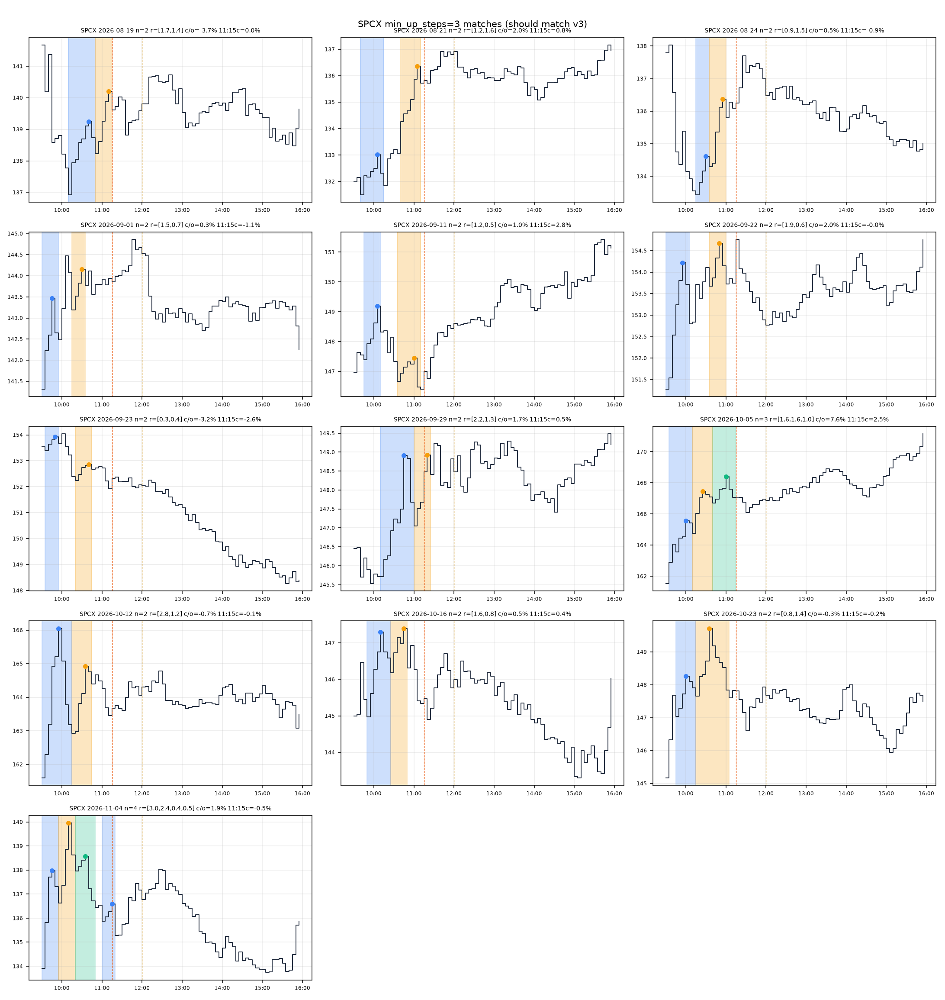
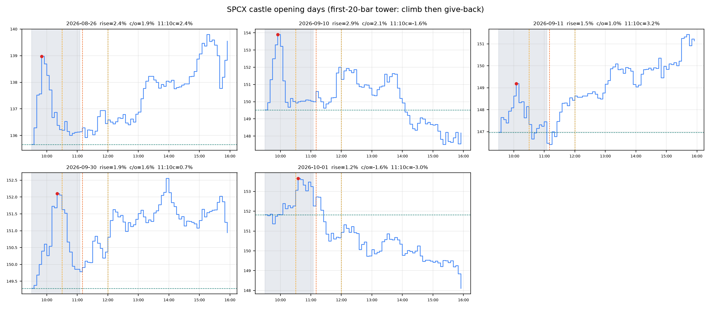
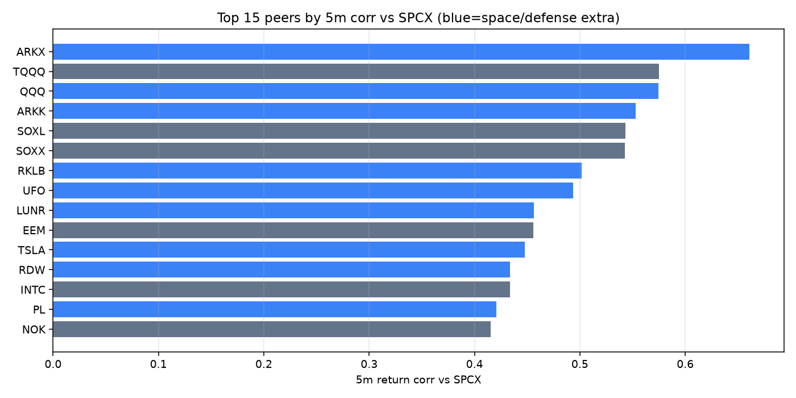

# SPCX intraday pattern research

This note summarizes intraday pattern research on SPCX, Space Exploration Technologies Corp. (Nasdaq: SPCX, yfinance exchange code NMS). Prices came from yfinance. The scans are ordinary Python rules with a fee and a baseline. There is no machine-learning model, and no orders were sent.

The lead result is a **step castle** rule on 5-minute regular-hours bars. The rule bought on 13 of 60 sessions, at 11:15 ET or at the next bar open after the second castle pullback, and sold at 12:00 ET. Those 13 trades finished higher 10 times (hit rate 76.92%). The average net return was 0.27%, with a 95% bootstrap interval of [0.01%, 0.57%]. The same 11:15-to-12:00 clock on all 60 days hit 53.33% and averaged 0.17%. A two-sided binomial test of the 13-trade hit rate against that all-days rate gives p = 0.1016. The same entries held to 13:00 or to the close do not keep that hit rate (61.54% and 53.85%).

## Run this research yourself

The research in this repository was run with the [Momentum Backtester on Grok Bot](https://x.ai/bot/w9HXpfxHVunBEsnXKFHKv), which turns a trading idea into a Python backtest with walk-forward tests, fees, and baselines. Research only: no trades, and no financial advice.

## Caveats

Read this before treating 0.27% as a strategy.

- **13 trades.** The noon hit rate is 10 of 13 (76.92%). The two-sided binomial p-value against the all-days hit rate is 0.1016. The 95% interval for the average, from 5,000 bootstrap resamples in the script, is [0.01%, 0.57%]. That interval clears zero by a small margin. The 13:00 interval is [-0.17%, 0.45%] and the close interval is [-0.47%, 1.01%]. Both include zero.
- **Short history.** Daily bars start on 2026-06-12 (103 bars). The 5-minute regular-hours sample is 60 sessions, from 2026-08-14 through 2026-11-06. yfinance is what limits those windows.
- **The rules saw these same days.** Sep 11 is the worked example for the step castle. The early-climb rule was written from Sep 8, Sep 11, Oct 12, and Oct 21, so those four labels are in-sample. The 11:10 dip check was chosen by looking at the original SPCX dip matches, so that SPCX result is in-sample too. A rule shaped on the days you score will look cleaner than the same frozen rule on new days.
- **The leftover is thin.** The 0.27% noon average is already net of 1 basis point per side. A live spread or a worse fill can take that. This research does not measure the live SPCX spread.
- **Many variants, one session.** Momentum swept 192 configs. The band study swept 144. Pattern scans added dip, climb, single castle, double castle, template match, and the step castle, including a 2-step versus 3-step check. The summaries are timestamped from 14:45 to 16:11 America/Chicago on 2026-11-06. The printed p-values are not corrected for that search.
- **Research only.** This is not financial advice. No trades were placed. Past results do not predict future results.

The useful next step is a forward paper test. Freeze the step castle rule (at least 3 up steps, entry at the later of 11:15 and the bar after the second pullback, exit at 12:00, 1 bp per side) and score only new sessions.

## Data

| Series | Request | Bars | Sessions | Start | End |
|---|---|---:|---:|---|---|
| 5-minute | 60d | 4680 | 60 | 2026-08-14 09:30 ET | 2026-11-06 15:55 ET |
| 15-minute | 60d | 1559 | 60 | 2026-08-14 09:30 ET | 2026-11-06 15:30 ET |
| 1-hour | 730d | 699 | 100 | 2026-06-12 11:30 ET | 2026-11-06 15:30 ET |
| Daily | max | 103 | | 2026-06-12 | 2026-11-06 |

Source: yfinance, regular trading hours for the intraday series. The first daily bar is 2026-06-12. Currency is USD. The momentum study's quoted last close was 134.41000366210938, and that study recorded a price match within $1 of a separate end-of-day chart. Last closes differ slightly by bar size in the archived tables, because each series stops on its own last bar.

Costs in every test below are 1 basis point per side, with 0 commission in the momentum study. That study and the band study also reprint a 2x cost column. Returns quoted here are the 1 bp versions unless a sentence says otherwise.

The step castle, the shape scans, the dip scan, and the early-climb scan use the 5-minute bars. The momentum study uses 15-minute, 1-hour, and daily bars. The band study uses 5-minute, 15-minute, and 1-hour bars.

## Step castle rule

A step castle is a staircase, then a pause. On the 5-minute close path:

1. Count a run of at least 3 up steps (close to close). At most one down step may sit inside the run, and that down step must be smaller than half the average up step so far.
2. The run ends at a local peak.
3. Price then pulls back by at least 25% of the rise from the start of the run to the peak.
4. A rise made mostly by one bar is a false castle. If the largest up step is more than 50% of the rise, the run is rejected.
5. The rise from the start of the castle to its peak is capped at 5% of the start price. The script also skips a rise under 0.3% (`MIN_RISE = 0.003`).

A **match day** has at least two accepted castles whose pullbacks end by about 11:30 ET. The scan looks through the noon bar.

The **trade**, fixed before the count: enter at the open of the bar after the second pullback ends, and not before 11:15 ET. In code that is `max(after the second pullback, 11:15)`. Exit at 12:00, with the same entries also scored at 13:00 and at the session close. The baseline buys every session at the 11:15 open and uses the same exits.

Day types on the 60 sessions, for a minimum of 3 up steps (the 2-step minimum produces the same counts):

| Day type | Days |
|---|---:|
| Two or more castles by about 11:30 (matches) | 13 |
| One castle | 27 |
| False jumps only | 20 |
| No castle and no false jump | 0 |

## September 11, the worked example

Sep 11, 2026 is the session used to check that the detector sees a staircase and rejects a single jump. Both the 3-step and the 2-step settings find the same two castles and reject the same two morning jumps.

| Clock (ET) | Verdict | Rise | Up steps | Largest step / rise |
|---|---|---:|---:|---:|
| 09:30 start, peak 09:35 | False jump, too few steps | 0.46% | 1 bar | 1.00 |
| 09:45 start, peak 10:05, pullback ends 10:10 | Castle | 1.22% | 4 | 0.32 |
| 10:20 start, peak 10:25 | False jump, too few steps | 0.35% | 1 bar | 1.00 |
| 10:35 start, peak 11:00, pullback ends 11:10 | Castle | 0.54% | 4 | 0.35 |

Plain reading: the 09:30 and 10:20 moves are one bar each, so the largest step is the whole rise and the step count is too small. The 09:45 and 10:35 moves are four up steps each, and the largest step is 0.32 and 0.35 of the rise. The second pullback ends at 11:10, so the entry on this day is the 11:15 open. The session row in the match table below shows 11:15-to-close of 2.82% and trade-to-close of 3.19%. Those are the close exits, which are a different holding period from the noon result.

With the minimum lowered to 2 up steps, the 09:30 and 10:20 jumps stay false, because a single bar still has a largest-step share of 1.00. Two later Sep 11 bumps are also rejected as dominant bars: 11:30 (rise 0.28%, largest step 0.97 of the rise) and 11:45 (rise 0.29%, largest step 0.82).

## What the step castle test showed

Figures below are for `min_up_steps = 3`. They match the v3 SPCX run (the v4 reproduce check returned ok). Net of 1 bp per side.

| Exit | Match n | Hit rate | Average | Median | 95% CI | All days n | All-days hit | All-days average | Binomial p |
|---|---:|---:|---:|---:|---|---:|---:|---:|---:|
| 12:00 | 13 | 76.92% | 0.27% | 0.27% | [0.01%, 0.57%] | 60 | 53.33% | 0.17% | 0.1016 |
| 13:00 | 13 | 61.54% | 0.10% | 0.07% | [-0.17%, 0.45%] | 60 | 48.33% | -0.00% | 0.4115 |
| Close | 13 | 53.85% | 0.24% | 0.01% | [-0.47%, 1.01%] | 60 | 45.00% | -0.19% | 0.5842 |

The noon average and the noon median are both 0.27%. The three noon losers, from a negative `trade_exit_1200` in the CSV, are 2026-09-22, 2026-10-05, and 2026-10-23. The other 10 match days are positive on that column.

Entry time is 11:15 ET on 11 of the 13 days. The second pullback finished later on 2026-08-19 (entry 11:20) and on 2026-09-29 (entry 11:30).

A split of the sample at 2026-09-28, still with the 3-step rule:

| Half | Exit | Match n | Hit rate | Match average | All-days average | Binomial p |
|---|---|---:|---:|---:|---:|---:|
| Through 2026-09-28 | 12:00 | 7 | 85.71% | 0.36% | 0.24% | 0.1373 |
| After 2026-09-28 | 12:00 | 6 | 66.67% | 0.17% | 0.09% | 0.6886 |
| Through 2026-09-28 | Close | 7 | 57.14% | 0.05% | 0.10% | 1 |
| After 2026-09-28 | Close | 6 | 50.00% | 0.47% | -0.50% | 0.3827 |

Both halves are a handful of trades. The noon hit rate is 85.71% on 7 days in the first half and 66.67% on 6 days in the second half.

### Two steps versus three steps

Lowering the minimum from 3 up steps to 2 did not add or remove a match day. Hit rates and averages in the table above are the same at 2 and at 3. The printed bootstrap bounds move slightly, because they are resampled: the noon interval is [0.01%, 0.57%] at 3 steps and [0.02%, 0.57%] at 2 steps, and the close interval is [-0.47%, 1.01%] versus [-0.50%, 1.01%]. The 13 dates are:

2026-08-19, 2026-08-21, 2026-08-24, 2026-09-01, 2026-09-11, 2026-09-22, 2026-09-23, 2026-09-29, 2026-10-05, 2026-10-12, 2026-10-16, 2026-10-23, 2026-11-04.

The big-bar rule is why a 2-step minimum changes so little. A one-bar jump still has a largest-step share of 1.00, so it stays a false castle. Two similar steps can pass. On this sample, no extra day reached two accepted castles by about 11:30.

## The 13 match days

Shaded bands are the castles whose pullbacks ended by about 11:30. Dots mark peaks. Dashed vertical lines mark 11:15 and 12:00. Panel titles use the script's one-decimal rounding; the table under the chart uses the summary's printed figures.



`n` is the count of castles with a pullback done by about 11:30, which is the match count. Close-to-open, 11:15-to-close, and trade-to-close come from the v3 summary. The CSV also records castles later in the day: 2026-10-16 has 3 castles in total and 2 by 11:30, and 2026-11-04 has 5 in total and 4 by 11:30.

| Date | n | Castle rises | Close vs open | 11:15 to close | Trade to close |
|---|---:|---|---:|---:|---:|
| 2026-08-19 | 2 | 1.69%, 1.43% | -3.67% | 0.02% | 0.01% |
| 2026-08-21 | 2 | 1.15%, 1.56% | 1.95% | 0.82% | 0.89% |
| 2026-08-24 | 2 | 0.88%, 1.55% | 0.52% | -0.92% | -0.81% |
| 2026-09-01 | 2 | 1.52%, 0.67% | 0.28% | -1.12% | -1.19% |
| 2026-09-11 | 2 | 1.22%, 0.54% | 1.04% | 2.82% | 3.19% |
| 2026-09-22 | 2 | 1.94%, 0.65% | 2.01% | -0.01% | 0.63% |
| 2026-09-23 | 2 | 0.35%, 0.40% | -3.23% | -2.57% | -2.34% |
| 2026-09-29 | 2 | 2.20%, 1.27% | 1.71% | 0.48% | 0.50% |
| 2026-10-05 | 3 | 1.64%, 1.63%, 1.02% | 7.61% | 2.46% | 2.43% |
| 2026-10-12 | 2 | 2.76%, 1.23% | -0.74% | -0.12% | -0.01% |
| 2026-10-16 | 2 | 1.60%, 0.83% | 0.47% | 0.38% | 0.47% |
| 2026-10-23 | 2 | 0.84%, 1.39% | -0.29% | -0.22% | -0.25% |
| 2026-11-04 | 4 | 3.04%, 2.44%, 0.44%, 0.54% | 1.94% | -0.55% | -0.34% |

Exact noon returns are `trade_exit_1200` in [results/data/spcx_min3_v4.csv](results/data/spcx_min3_v4.csv). This table's last column is the close exit, so a green close can still be a noon loser (2026-09-22 and 2026-10-05).

## What did not work

The SPCX numbers below are the ones each summary printed. Each row is a finished test.

| Test | What was fixed in advance | SPCX result | How to read it |
|---|---|---|---|
| High-mode momentum | Go long when recent up closes beat down closes by count or by size. 192 configs. Best config on the first 70% of bars, scored on the last 30%. | 15-minute test return **-11.41%** (37 trades, hit 37.84%, random percentile 36.6) after a train return of 29.09%. 1-hour test return **-6.62%** (31 trades, hit 32.26%, random percentile 17.9) after train 42.42%. Daily: no config reached 30 train trades on 72 train bars. Buy-and-hold on those tests: 15-minute -14.41%, 1-hour -9.53%, daily -9.50%. | Train looked strong. Test was negative and below the random median. Flags on both intraday rows: overfit warning, below random median, negative test return. |
| Band-width day trader | Long only when recent absolute steps are narrow and still mostly up. No entry before 11:00 ET. Flat overnight. 144 configs. 70/30 split by day. | 5-minute test return **-2.90%** on 16 trades, hit 25.00%, random percentile 20.5. Same test window: buy-and-hold -13.42%, every day from 11:00 to the close -12.78%. 15-minute test -2.71% (hit 35.71%, percentile 37.3). 1-hour test -2.61% (4 trades, hit 0.00%, percentile 14.5). | The test lost money on every bar size and sat below the random median. The 5-minute loss was smaller than buy-and-hold, and it was still a loss. |
| Early dip and recover | A drop of at least 1.0% in the first 30 minutes, with heavy volume, a halfway snap-back by 12:00, then a narrow up-step check. | **5 of 60** days on 5-minute bars. Average midday-to-close net **-0.41%**, versus -0.38% on all 60 days. Share of days that closed above the check: 20.00%, versus 40.00% on all days. On 15-minute bars, 3 of 60 days, average -0.52% versus -0.37% on all days. | The matches did not beat the all-days baseline. |
| 11:10 check on that dip | Same dip rules. Only the check clock moves, from 12:00 to about 11:10 ET. | SPCX at 12:00: 5 matches, average midday-to-close net -0.41%. SPCX at 11:10: **4 matches, average 0.19%** (share close above the check 75.00%, versus 46.67% on all 60 days). | The 11:10 clock was picked by looking at these same SPCX days. The 0.19% figure is in-sample. |
| Early climb of about 2% | From 09:30 to 10:30, rise from the window low in the band 1% to 2.6%. Buy the 10:30 open, sell the 12:00 close. | GOOD group: **11 of 14** won (hit 78.57%), average net 0.67%, median 0.51%, 95% CI [-0.09%, 1.45%]. Binomial p = 0.1058 versus the all-days hit rate of 55.00% (all-days average 0.12%). After 2026-09-28: 5 GOOD days, hit 60.00%, average -0.15%. | The CI includes zero. The four example dates used to write the rule are inside this sample. The later half does not keep the early average. |
| Single castle shape | One opening tower on the close path, rise 1% to 3.5%, then a give-back of at least 60% of that rise by about 11:05. | **5 of 60** days. Sep 11 matched, with a rise of 1.51% and a give-back of 1.22 times the rise. | A visual count. The scan states no edge claim. |
| Double castle shape | Two separated towers between 09:30 and 12:00, each with a rise of 0.7% to 5% and a 60% give-back. | **4 of 60** days (2026-08-19, 2026-09-22, 2026-10-12, 2026-10-16). | A count only. The scan states no edge claim. |
| Template match | Correlation of the 09:30 to 11:15 shape with Sep 11 and Sep 30. Keep a day when correlation is at least 0.7 and the local peak rise is at most 5%. | **2** non-template days passed: 2026-11-04 (corr 0.764, 11:15-to-close -0.55%) and 2026-09-17 (corr 0.763, 11:15-to-close 0.48%). Group average 11:15-to-close **-0.03%**, and 50% of them closed above the 11:15 price. | Two days. The summary says this is not an edge claim. |

The five single-castle days are a different list from the 13 step-castle days. Only Sep 11 is in both.



## Peer correlations

Daily return correlation with SPCX, from the first daily bar on 2026-06-12 (102 return bars, 103 close bars). The 5-minute column uses the same roughly 60-session window. Best lag is in 5-minute bars. Lag 0 means the bars line up at the same time.

| Ticker | Daily corr | 5-minute corr | 5-minute best lag |
|---|---:|---:|---:|
| ARKX | 0.707 | 0.661 | 0 |
| UFO | 0.605 | 0.493 | 0 |
| ARKK | 0.560 | 0.553 | 0 |
| RKLB | 0.514 | 0.502 | 0 |
| QQQ | 0.484 | 0.575 | 0 |

On the top 15 names by 5-minute correlation, every best lag is 0. Nothing in that list leads SPCX. A separate lead/lag screen (best lag negative, and absolute correlation at least 0.005 above the lag-0 correlation) only turns up weak names. The largest absolute correlation on that list is 0.065 (PINS, lag -2), against 0.041 at lag 0. Correlation is not causation, and 102 daily return bars is a short sample. The peer scan tried 102 candidates. One daily series failed to load (SATS). No 5-minute series failed.



## How the tests were run

- **Code.** Plain Python. The attached scripts use pandas, numpy, matplotlib, and scipy. The price history was downloaded with yfinance and then read from cached bars. There is no fitted machine-learning model.
- **Rules first, where the scan is a pattern.** Dip, early climb, single castle, double castle, template match, and the step castle state the rule and then count. The step castle summary describes the rules as fixed, with no optimization pass over the thresholds.
- **Train, then test, where the scan is a grid.** Momentum (192 configs) and the band trader (144 configs) pick the best config on a chronological train window and report that config on the later window. Momentum uses the first 70% of bars and requires at least 30 train trades. The band study uses a 70/30 split by day and requires at least 15 train trades.
- **Baselines.** Buy-and-hold. A same-clock trade on every day (11:15 open for the step castle, 11:00-to-close for the band study, midday-to-close for the dip). For the two grids, 1,000 random-entry runs with the same trade count and hold, reported as a percentile of the test result.
- **Inside the step castle sample.** Match days versus all 60 days, plus a half split at 2026-09-28. That split is a check, and it is still the same 60 days.
- **Search risk.** The variants above were all tried in one session. A single binomial p-value of 0.1016 does not pay a penalty for the other scans. Treat the noon result as a hypothesis for a forward paper test.

## Reproduce the scripts

Install the libraries the research used:

```bash
pip install pandas numpy yfinance matplotlib scipy
```

Two scripts are in this repo:

- [scripts/castle_steps_v4.py](scripts/castle_steps_v4.py) compares a minimum of 2 up steps with a minimum of 3, on SPCX only, and writes the noon, 13:00, and close statistics.
- [scripts/castle_steps_v3.py](scripts/castle_steps_v3.py) is the 3-step detector those figures were checked against.

They do not download data themselves. Both insert `/workspace/backtester` on the Python path and import `load_bars`, `session_days`, `unique_path`, and `fmt_pct` from `spcx_dip_scan`. Both read `/workspace/backtester/data_bands_SPCX_5m_v5.csv`. v4 also looks for `/workspace/backtester/castle_steps_spcx_v3.csv` when it checks that the 3-step matches still agree. v3 also reads a 5-minute cache under `/workspace/backtester/multi_data`. That helper module and those caches are not in this repository, so `python scripts/castle_steps_v4.py` will not run from a fresh clone until that local tree is present.

The momentum and band studies are documented in the archived summaries. Their scripts were not part of the files saved here, so those two grids cannot be rerun from this repo alone. Their data ranges, configs, and SPCX test numbers are in the summaries linked below.

## Files

Archived summaries are stored as they were produced. Some of them also contain tables for other tickers from the same session. This page quotes SPCX, plus the peer correlations above.

| File | What it is |
|---|---|
| [results/summaries/castle_steps_v4.md](results/summaries/castle_steps_v4.md) | Step castle, 2-step versus 3-step, SPCX |
| [results/summaries/castle_steps_v3.md](results/summaries/castle_steps_v3.md) | Step castle definition, Sep 11 check, the 13-day table |
| [results/data/spcx_min3_v4.csv](results/data/spcx_min3_v4.csv) | One row per session for the 3-step rule, including noon returns |
| [results/charts/spcx_matches_min3_grid_v4.png](results/charts/spcx_matches_min3_grid_v4.png) | The 13 match days |
| [results/summaries/high_mode_momentum.md](results/summaries/high_mode_momentum.md) | Close-to-close momentum grid |
| [results/summaries/band_day_trader.md](results/summaries/band_day_trader.md) | Band-width day trader, entries at or after 11:00 ET |
| [results/summaries/early_dip_scan.md](results/summaries/early_dip_scan.md) | Early dip and midday snap-back |
| [results/summaries/dip_check_1110_vs_1200.md](results/summaries/dip_check_1110_vs_1200.md) | 12:00 check versus the 11:10 check |
| [results/summaries/early_climb_v1.md](results/summaries/early_climb_v1.md) | Early climb, buy 10:30, sell 12:00 |
| [results/summaries/castle_opening_v1.md](results/summaries/castle_opening_v1.md) | Single opening-castle shape, 5 of 60 |
| [results/charts/castle_opening_matches_grid_v1.png](results/charts/castle_opening_matches_grid_v1.png) | Those five days |
| [results/summaries/double_castle_v1.md](results/summaries/double_castle_v1.md) | Double-castle shape, 4 of 60 |
| [results/summaries/castle_template_v2.md](results/summaries/castle_template_v2.md) | Template correlation with Sep 11 and Sep 30 |
| [results/summaries/spcx_peers_v1.md](results/summaries/spcx_peers_v1.md) | Peer correlations and the lead/lag screen |
| [results/charts/spcx_peers_top15_m5corr_v1.png](results/charts/spcx_peers_top15_m5corr_v1.png) | Top 15 peers by 5-minute correlation |
